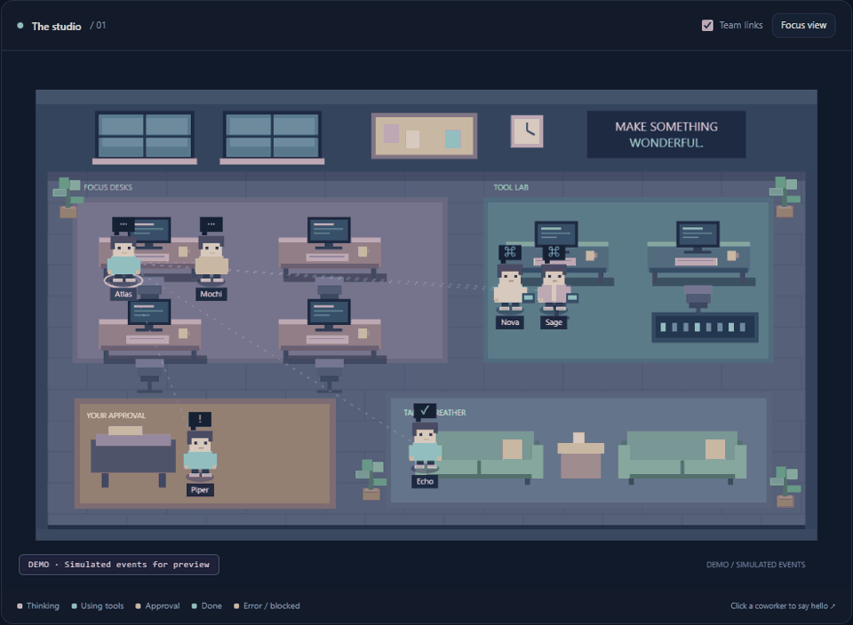
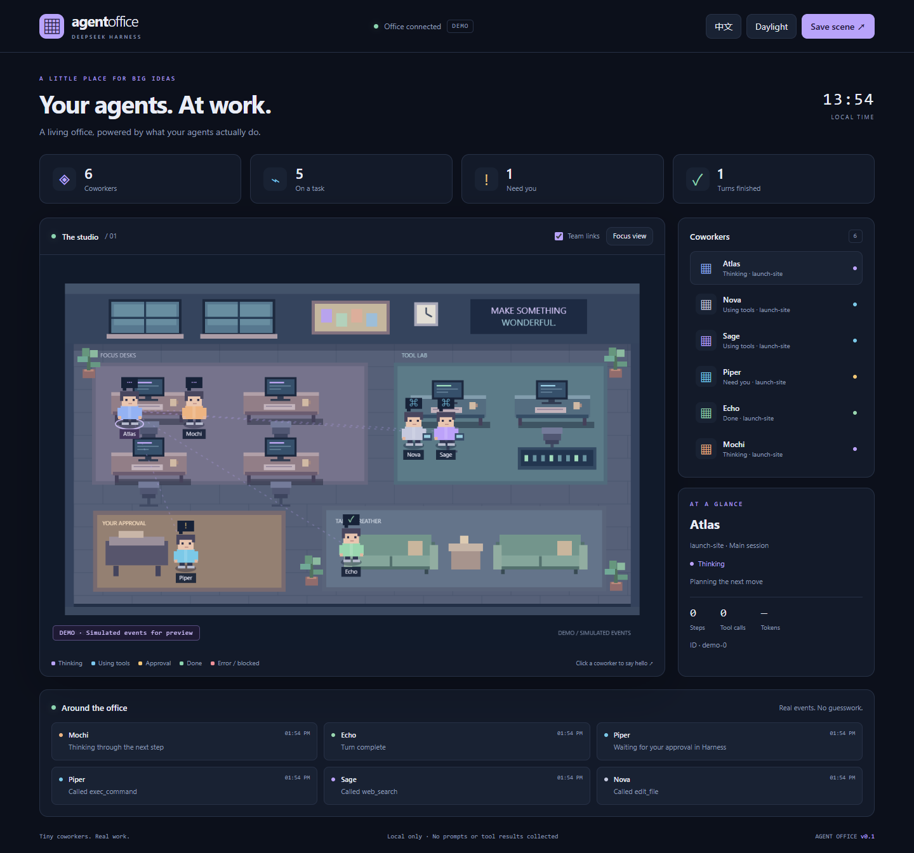

# Agent Office · Agent 工作实况桌面

**小小同事，认真工作。** 把 DeepSeek Harness 中真实运行的 Agent，变成像素办公室里的同事。

[English](README.md) · MIT 开源 · 无运行时依赖 · 无需额外 API Key



Agent 思考时待在工位，调用工具时走向实验台，需要审批时来到等候区，回合完成后去休息。点击小人或成员列表，可以查看状态与最近活动。真实模式的状态来自 Harness 的会话事件。

## 先看效果

下载项目，在项目文件夹中运行：

```sh
git clone https://github.com/xx-ytg/dsh-agent-office.git
cd dsh-agent-office
node src/demo.mjs
```

打开 **http://127.0.0.1:4319**，无需安装依赖、模型或密钥。此命令是独立演示，界面会明确标注“模拟数据”，不会自动接入已运行的 Harness。

## 接入真实 Harness

需要 Node **22.19+** 与 DeepSeek Harness **0.2.1-alpha.4**。当前兼容声明只覆盖已核对的版本。

在包含 `dsh-agent-office` 文件夹的上级目录运行：

```sh
dsh plugin --profile office add ./dsh-agent-office
dsh --profile office web
```

没有全局安装 `dsh` 时，可将命令中的 `dsh` 替换为 `npx @deepseek-ai/dsh@0.2.1-alpha.4`。按正常流程配置该 profile 的模型。打开 **http://127.0.0.1:4319**，然后在 Harness 中启动任务。

接入已有 profile 时，把 `office` 替换为其名称。安装后重启 Harness。先关闭独立演示，避免争用 4319 端口。第一版是独立浏览器桌面，尚未嵌入 Harness 侧边栏，也不是操作系统桌面悬浮窗。

也可以直接加载本地源码：

```sh
node scripts/make-patch.mjs > office.local.patch.yml
dsh --profile office web --patch ./office.local.patch.yml
```

脚本生成使用绝对模块路径的 overlay；无需安装组合包。

## 已实现

- 原创程序绘制像素办公室：工位、实验台、审批角、沙发、植物与动态角色。
- 真实主会话和子 Agent 状态；团队虚线表示会话父子关系，不表示推测的交流。
- 并行工具和多个审批独立计数，避免一个完成就错误地清空整个状态。
- 正确区分完成、错误、受阻与暂停。“完成”指回合结束，不代表需求已验收。
- 点击成员查看工具调用数、思考步数、模型实际报告的 Token 和最近事件。
- 中英文、日光 / 午夜主题、专注模式、手机布局、减少动画支持、PNG 截图导出。
- 断线自动重连，并提示正在展示最后已知状态。



## 配置

在 profile overlay 中覆盖该行：

```yaml
- id: agent-office
  config:
    port: 4320
    maxAgents: 48
    maxEvents: 120
```

默认端口 `4319`；默认追踪 48 个会话、保留 120 条活动。端口范围 1024–65535，成员数 1–200，事件数 10–500。配置不合法时拒绝加载。

场景同时绘制最多 **12 位成员**，列表仍可选择全部已追踪会话，选择其他成员会把它带到场景中。达到追踪上限时优先淘汰非活动会话；如果全部正在执行，则暂时忽略新会话。统计只覆盖本次启动期间仍被保留的会话，活动区域显示最新六条事件。

端口冲突会输出错误，Harness 本身继续运行；修改端口并重启即可。

## 数据说明与当前边界

只监听 `session/event` 和 `session/disposed`，不修改工具执行、模型行为或审批逻辑。审批请回到原 Harness 会话处理。

仅保留会话 ID、父会话 ID、自动生成的名称、工作目录最后一级名称、工具名、状态、时间和实际报告的 Token。不会保存提示词、回复正文、推理内容、工具参数 / 结果、完整路径或审批解释，不发送遥测数据。

服务仅绑定 `127.0.0.1`，校验 Host / Origin，没有写入接口。元数据对同机可访问本地端口的进程可见；本版面向可信的本机使用，不应把端口暴露到公网。

状态保存在内存，重启后清空；不会导入旧历史或其他 Harness 进程的会话。插件加载前已开始的任务，会在下一个可观察事件到来后出现。卸载插件会关闭服务。

## 验证

```sh
node --test
```

已通过 8 项自动测试，并用真实发布的 Cordis **4.0.5-alpha.2** 和 SessionStore **0.2.1-alpha.4** 验证事件接入与卸载清理。浏览器检查覆盖布局、双语、主题、点击、专注模式和截图导出。尚未运行完整模型驱动的 Harness 端到端任务，详见 [验证记录](docs/VERIFICATION.md)。

## 发布素材

`docs/demo.gif`、`docs/screenshot.png`、`docs/daylight.png` 与 `docs/mobile.png` 可以用于 GitHub 展示；演示数据已标注。源码仓库：[xx-ytg/dsh-agent-office](https://github.com/xx-ytg/dsh-agent-office)。尚未发布到 npm。

建议仓库描述：**A living pixel office for DeepSeek Harness. Watch real agents think, use tools, and wait for you.**

建议 Topics：`dsh-plugin`、`deepseek-harness`、`ai-agents`、`pixel-art`、`agent-observability`。

MIT 许可证。独立社区插件，非 DeepSeek 官方产品。

